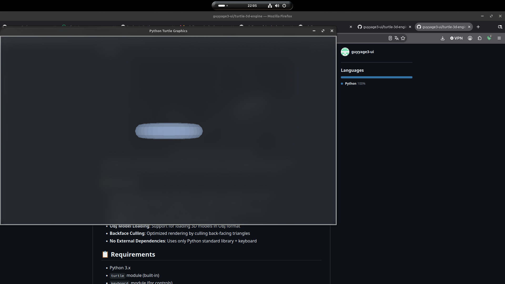
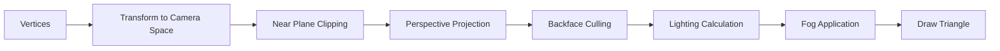
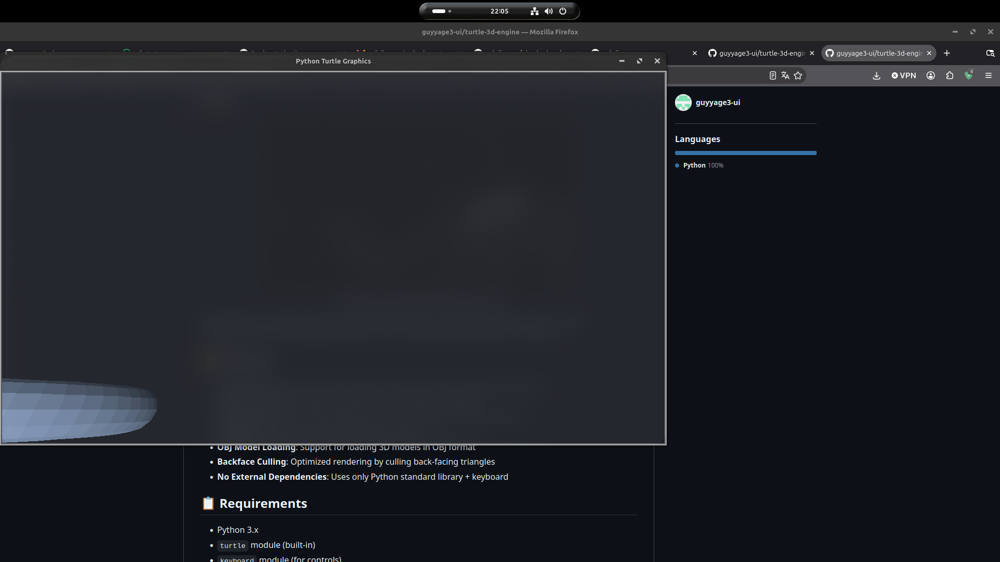
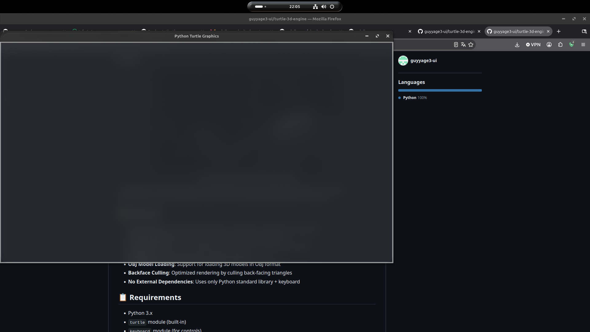

# Turtle 3D Engine

<p align="center">
  
  <br>
  <em>Default view of the 3D engine rendering a torus model</em>
</p>

A lightweight 3D rendering engine built with Python's built-in `turtle` graphics library. This project demonstrates real-time 3D graphics without external dependencies like OpenGL or Pygame.

## 🌟 Features

- **3D Rendering**: Triangle-based rasterization with depth sorting (Painter's Algorithm)
- **Camera Controls**: First-person style camera movement and rotation
- **Lighting System**: Directional lighting with normal-based brightness calculation
- **Fog Effects**: Distance-based fog for depth perception
- **OBJ Model Loading**: Support for loading 3D models in OBJ format
- **Backface Culling**: Optimized rendering by culling back-facing triangles
- **No External Dependencies**: Uses only Python standard library + keyboard

## 📋 Requirements

- Python 3.x
- `turtle` module (built-in)
- `keyboard` module (for controls)
- Optional: `pygltflib` for GLTF support
- Optional: `pyautogui` for screenshots

## 🚀 Installation

```bash
# Install required packages
pip install keyboard
pip install pygltflib  # optional for GLTF support
pip install pyautogui  # optional for screenshots
```

## 🎮 Usage

### Basic Rendering (OBJ Files)

```bash
python render.py
```

### Controls

| Key | Action |
|-----|--------|
| **W** | Move forward |
| **S** | Move backward |
| **A** | Move left |
| **D** | Move right |
| **Space** | Move up |
| **Shift** | Move down |
| **↑** | Rotate up |
| **↓** | Rotate down |
| **←** | Rotate left |
| **→** | Rotate right |

<p align="center">
  
  
</p>

## 📁 Project Structure

```
turtle-3d-engine/
├── render.py          # Main rendering engine with camera, lighting, and drawing
├── obj_loader.py      # OBJ file loader with normal generation
├── gltf_loader.py     # GLTF file loader (requires pygltflib)
├── make_screenshots.py # Script to capture engine screenshots
├── monkey.obj         # Sample 3D model (Torus)
├── monkey.mtl         # Material file for the model
└── README.md          # This file
```

## 🔧 Technical Details

### Rendering Pipeline



### Camera System
- Horizontal and vertical rotation with clamping
- Position-based movement relative to camera orientation
- Perspective projection with configurable focal length (500 pixels)
- Near plane clipping at 0.1 units

### Lighting
- Directional light source with automatic normalization
- Normal-based brightness calculation using dot product
- Ambient minimum brightness (20%) to prevent total darkness
- Automatic light vector updates on rotation

### Rendering Algorithm
- **Painter's Algorithm**: Triangles are sorted by depth and rendered farthest first
- **Perspective Projection**: `sx = (x / z) * focal_length`
- **Near Plane Clipping**: Triangles with z ≤ 0.1 are discarded
- **Backface Culling**: Uses cross product to determine triangle winding order

### OBJ Loader Features
- Loads vertices and normals from OBJ files
- Automatic normal generation if normals are missing
- Triangulation of polygon faces
- Support for missing normal indices

## 🎯 Example Code

### Basic 3D Rendering

```python
import turtle
from obj_loader import load_obj

# Setup screen
turtle.setup(1280, 720)
screen = turtle.Screen()
screen.bgcolor("#22252b")

# Load model
verts, normals, tris = load_obj("monkey.obj")

# Render loop
while True:
    # Your rendering code here
    pass
```

### Camera Movement

```python
# Camera variables
camera_x = 0
camera_y = 0
camera_z = -5
rot_h = 0  # Horizontal rotation
rot_v = 0  # Vertical rotation

# Movement controls
if keyboard.is_pressed("w"):
    camera_x += sin_h * move_speed
    camera_z += cos_h * move_speed
```

## 📊 Configuration

| Parameter | Value | Description |
|-----------|-------|-------------|
| Window Size | 1280x720 | Display resolution |
| Focal Length | 500 | Perspective projection factor |
| Near Plane | 0.1 | Minimum z-distance for rendering |
| Base Color | (180, 210, 255) | Light blue triangle color |
| Fog Factor | z/80 | Distance-based fog calculation |

## 💡 How It Works

1. **Model Loading**: OBJ files are parsed to extract vertices and normals
2. **Camera Transform**: Points are transformed relative to camera position
3. **Clipping**: Triangles behind the near plane are discarded
4. **Projection**: 3D coordinates are projected to 2D screen space
5. **Culling**: Back-facing triangles are removed for optimization
6. **Lighting**: Brightness is calculated based on surface normals
7. **Fog**: Distance-based fog is applied for depth effect
8. **Rendering**: Triangles are drawn using turtle graphics

## 📸 Screenshots

<p align="center">
  
  
  <br>
  <em>Default and rotated views of the 3D engine</em>
</p>

<p align="center">
  
  
  <br>
  <em>Top-down and side views showing different camera angles</em>
</p>

## 🤝 Contributing

Contributions are welcome! Please feel free to submit issues or pull requests.

## 📝 License

This project is provided as-is for educational purposes.

---

<p align="center">
  
  
</p>
